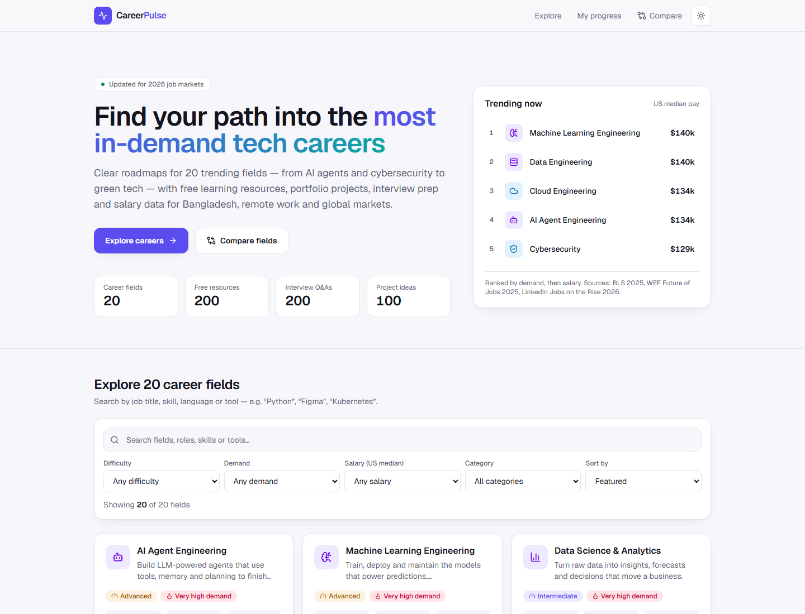
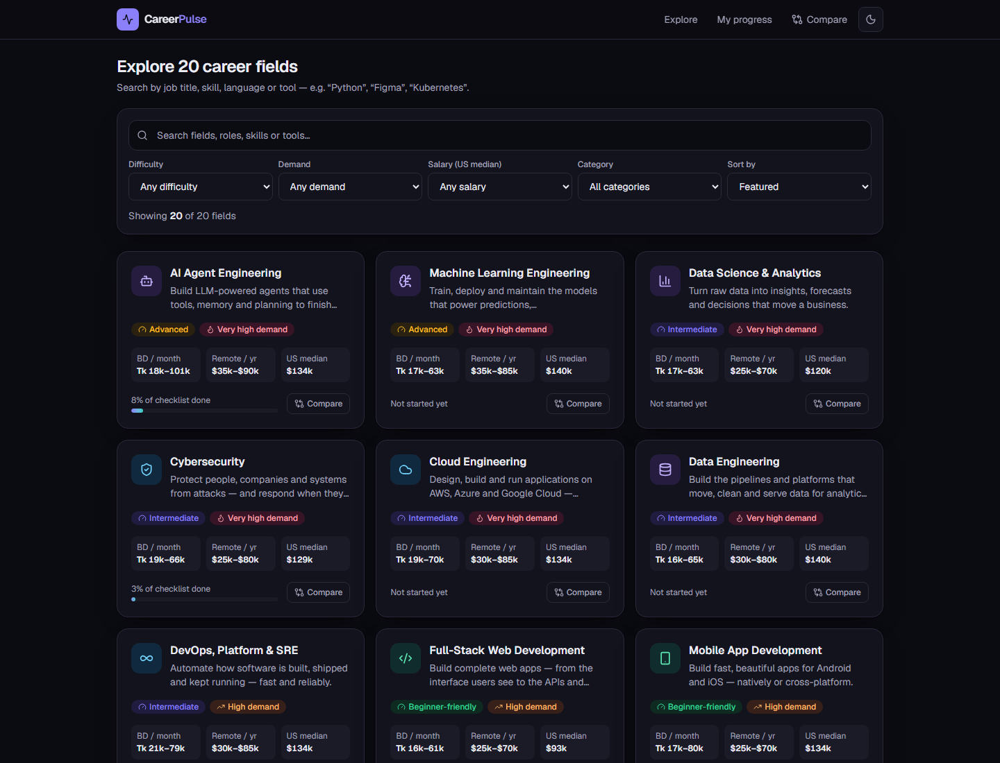
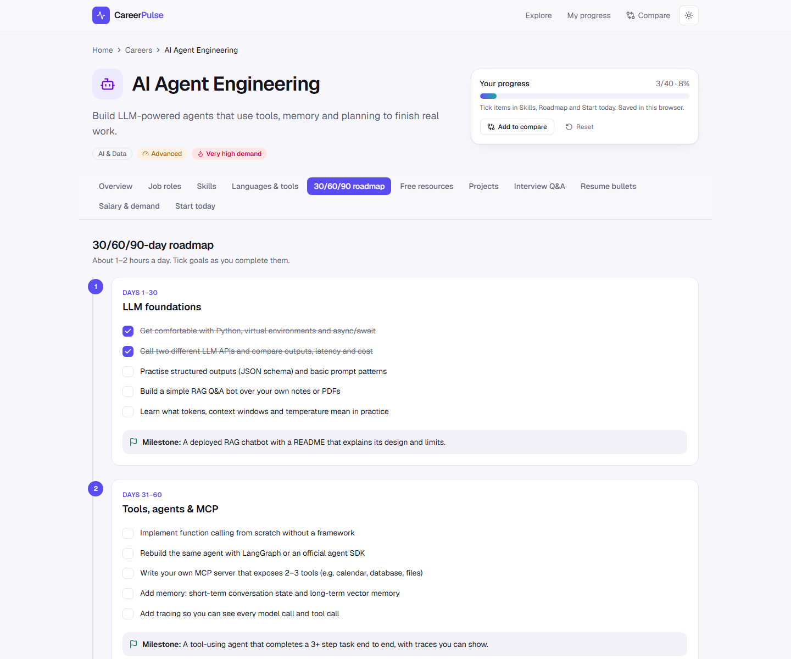
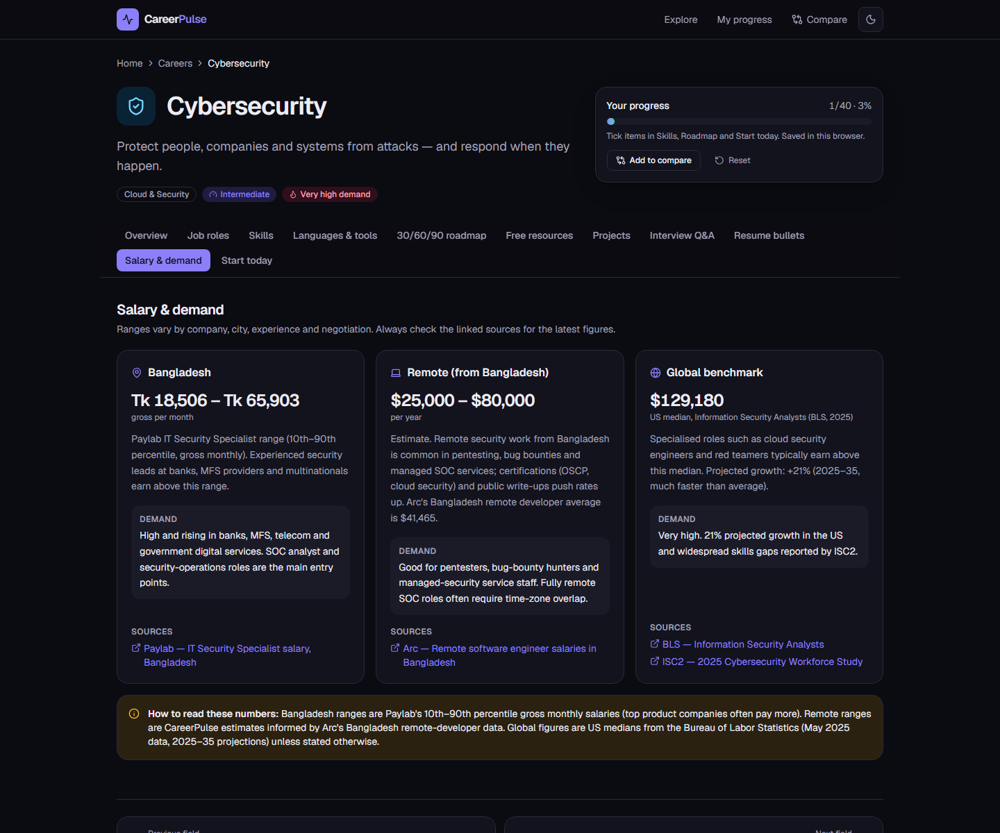
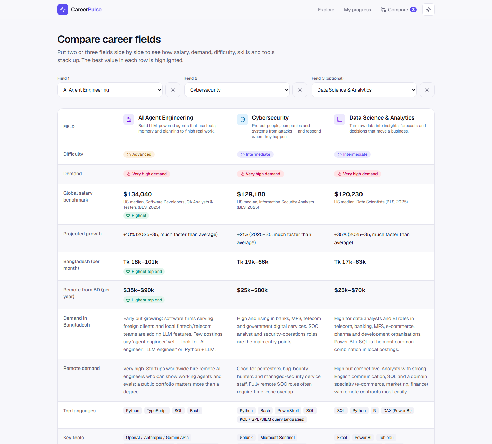
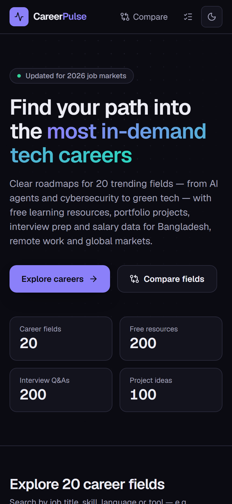
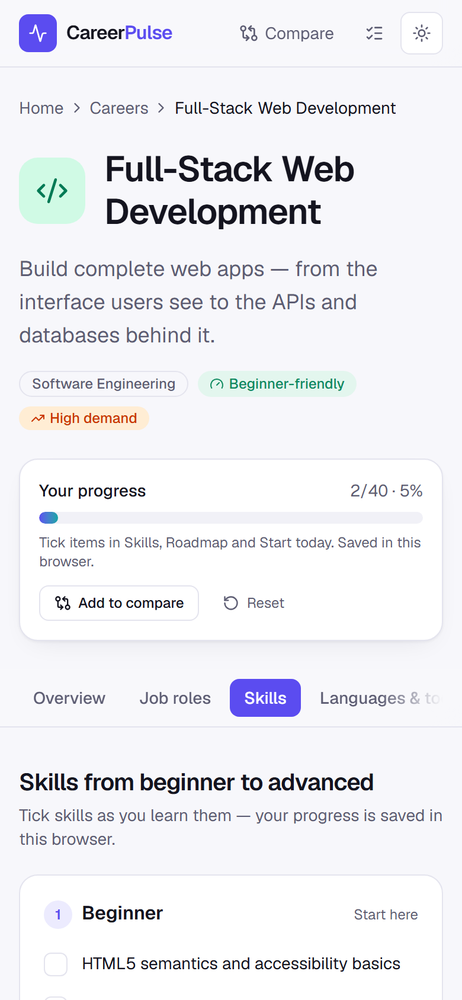

<div align="center">

# CareerPulse

**Research-based career roadmaps for 20 trending tech fields, with a focus on Bangladesh, remote work and global markets.**

[](https://nextjs.org)
[](https://react.dev)
[](https://www.typescriptlang.org)
[](https://tailwindcss.com)
[](https://vitest.dev)

**[Live demo](https://claude.ai/artifact/REtRnZWnPpk1JWvzbY6Bqz)** · [Features](#features) · [Tech stack](#tech-stack) · [Getting started](#getting-started)

</div>

CareerPulse helps students and career-switchers pick a tech career and start learning the same day. Each of the
20 fields comes with a plain-English explanation, job roles, a beginner → advanced skill list, the languages and tools
employers ask for, a 30/60/90-day roadmap, free resources, portfolio projects, interview questions, resume bullets,
and salary and demand data for **Bangladesh**, **remote work** and **global** markets. Every salary figure links to
its source.

## Screenshots

| Home (light)                                                      | Home (dark)                                                                             |
| ----------------------------------------------------------------- | --------------------------------------------------------------------------------------- |
|  |  |

| Field detail: 30/60/90 roadmap                                                     | Field detail: salary & demand (dark)                                           |
| ---------------------------------------------------------------------------------- | ------------------------------------------------------------------------------ |
|  |  |

| Compare 3 fields                                               | Mobile                                                                                                                                                            |
| -------------------------------------------------------------- | ----------------------------------------------------------------------------------------------------------------------------------------------------------------- |
|  |   |

## Features

- **20 researched career fields.** AI agents, ML, data science, data engineering, cybersecurity, cloud, DevOps/SRE,
  full-stack web, mobile, UI/UX, product management, prompt/context engineering, AI governance, fintech,
  embedded/IoT, green tech, robotics, AR/VR, blockchain and quantum computing.
- **11 tabs per field.** Overview & trends · Job roles · Skills · Languages & tools · 30/60/90 roadmap · Free resources ·
  Projects · Interview Q&A · Resume bullets · Salary & demand · Start today.
- **Search and filters.** Instant search across names, roles, skills and tools (e.g. "Kubernetes" or "Figma"), with
  filters for difficulty, demand, salary and category, plus five sort orders.
- **Progress tracking.** Tick skills, roadmap goals and "start today" tasks. Progress is saved in `localStorage`,
  stays in sync across tabs, and is summarised on the home cards and on a **My progress** dashboard.
- **Compare page.** Put 2–3 fields side by side. The best value in each row is highlighted. Selections live in the URL
  (`/compare?fields=a,b,c`), so you can share a comparison as a link.
- **Dark mode** with light / dark / system modes and no flash on load (an inline script runs before first paint).
- **Accessible and mobile-first.** Keyboard tab navigation (arrow keys, Home and End), a skip link, ARIA progress bars,
  visible focus rings, reduced-motion support and print styles.
- **Cited sources.** BLS Occupational Outlook (2025 data), Paylab Bangladesh, Arc.dev, WEF Future of Jobs 2025, ISC2,
  LinkedIn, IAPP and others. A link-checker script verifies all 250+ URLs.

## Tech stack

| Area      | Choice                                                            |
| --------- | ----------------------------------------------------------------- |
| Framework | **Next.js 16** (App Router, Cache Components, static generation)  |
| UI        | **React 19**, **TypeScript 5** (strict)                           |
| Styling   | **Tailwind CSS 4** with CSS-variable design tokens                |
| Icons     | lucide-react                                                      |
| Content   | Typed JSON files (`src/data/fields/*.json`) validated by tests    |
| State     | `useSyncExternalStore` + `localStorage` (no state library needed) |
| Testing   | **Vitest** + React Testing Library + jsdom (260+ tests)           |
| Quality   | ESLint (next/core-web-vitals + TypeScript), link checker          |

## Getting started

Requirements: **Node.js 20.9+** (developed on Node 24) and npm.

```bash
git clone https://github.com/<your-username>/careerpulse.git
cd careerpulse
npm install
npm run dev          # http://localhost:3000
```

### Scripts

| Command               | What it does                                                                               |
| --------------------- | ------------------------------------------------------------------------------------------ |
| `npm run dev`         | Start the dev server                                                                       |
| `npm run build`       | Production build (prerenders all 20 field pages)                                           |
| `npm start`           | Serve the production build                                                                 |
| `npm test`            | Run the Vitest suite once                                                                  |
| `npm run test:watch`  | Run tests in watch mode                                                                    |
| `npm run lint`        | ESLint                                                                                     |
| `npm run typecheck`   | Generate route types and run `tsc --noEmit`                                                |
| `npm run check-links` | Check every URL cited in the content                                                       |
| `npm run build:demo`  | Build the single-file demo (`demo/dist/`) from the same JSON content                       |
| `npm run format`      | Format with Prettier (+ Tailwind class sorting)                                            |
| `npm run screenshots` | Capture README screenshots from a running server (needs `npx playwright install chromium`) |

## Project structure

```
src/
├── app/                      # Next.js App Router
│   ├── page.tsx              # Home: hero + explorer (search/filter/sort)
│   ├── fields/[slug]/page.tsx# Field detail with 11 tabs (statically generated)
│   ├── compare/page.tsx      # Side-by-side comparison (URL-driven)
│   ├── progress/page.tsx     # Progress dashboard
│   ├── layout.tsx            # Header, footer, theme bootstrap
│   └── globals.css           # Tailwind v4 + design tokens (light/dark)
├── components/               # UI components (cards, explorer, tabs, sections…)
│   └── field/                # Detail-page sections, tabs, checklist items
├── data/fields/              # 20 career fields as JSON + typed index
├── hooks/                    # localStorage-backed stores (progress, compare tray)
└── lib/                      # Pure, tested logic: filter, format, progress, compare, theme
tests/                        # Vitest: data integrity, filters, lib, components
scripts/                      # check-links, screenshots, build-demo
demo/                         # Single-file demo template + built output (demo/dist)
docs/screenshots/             # README images
```

### Design decisions

- **Content as data.** Each field is one JSON file that follows the `Field` type in `src/lib/types.ts`.
  `tests/data.test.ts` enforces the content contract (4–6 roles, 8–10 resources, five projects ordered easy → hard,
  10 interview questions, sourced salary data and so on), so a bad edit fails CI.
- **Small client bundles.** Client components never import the full data set. The server passes only what they need,
  such as card summaries, checklist IDs and compare rows.
- **Stable progress IDs.** Checklist IDs are built from the item text (`slug:section:slugified-text`), so reordering
  content keeps a user's progress.

- **Real 404s.** Field pages stream, so `src/proxy.ts` rejects unknown slugs before rendering and returns a
  proper 404 status.

## Single-file demo

`npm run build:demo` renders the whole app (all 20 fields, search, compare, progress, dark mode) into one
dependency-free HTML file using the same JSON content. Open `demo/dist/careerpulse-demo-standalone.html`
directly in a browser, or host it anywhere static (GitHub Pages, Netlify Drop). It is useful as a quick, shareable
preview alongside the full Next.js app.

## Adding or editing a field

1. Copy any file in `src/data/fields/` and edit it. Your editor will flag type mismatches.
2. Register it in `src/data/fields/index.ts` (the array order is the "Featured" order).
3. Add an icon to `src/components/field-icon.tsx` if you need a new one.
4. Run `npm test` and `npm run check-links`.

## Deploying

The app is fully static apart from client-side state, so it runs anywhere that supports Next.js:

- **Vercel:** import the GitHub repo. No configuration is needed.
- **Any Node host:** `npm run build && npm start`.

Set `NEXT_PUBLIC_SITE_URL` to your production URL so Open Graph metadata uses the right domain.

## Push to GitHub

```bash
git init                      # skip if the folder is already a repo
git add -A
git commit -m "Initial commit: CareerPulse"
git branch -M main
git remote add origin https://github.com/<your-username>/careerpulse.git
git push -u origin main
```

Or with the GitHub CLI: `gh repo create careerpulse --public --source=. --push`.

## Data sources & methodology

- **Bangladesh:** [Paylab Bangladesh](https://www.paylab.com/bd/salaryinfo/information-technology), 10th–90th
  percentile gross monthly salaries for the closest matching job category (each field notes which category it used),
  plus [Levels.fyi Bangladesh](https://www.levels.fyi/t/software-engineer/locations/bangladesh) for top-company pay.
- **Remote:** CareerPulse estimates, informed by
  [Arc.dev's Bangladesh remote salary data](https://arc.dev/salaries/software-engineers-in-bangladesh).
- **Global:** US medians from the [BLS Occupational Outlook Handbook](https://www.bls.gov/ooh/) (May 2025 wages,
  2025–35 projections), or IAPP for AI governance.
- **Trends:** WEF Future of Jobs Report 2025, LinkedIn Jobs on the Rise 2026, Stack Overflow Developer Survey 2025,
  ISC2 Workforce Study 2025, LinkedIn Green Skills Report 2025, IEA, Gartner and others, all linked inside each field.

Salaries change, so treat every figure as a starting point and check the linked source. Content was researched in
October 2026.

## Continuous integration

`.github/workflows/ci.yml` runs lint, type-check, tests and a production build on every push and pull request.

## License

[MIT](LICENSE). Content is provided for educational purposes.
